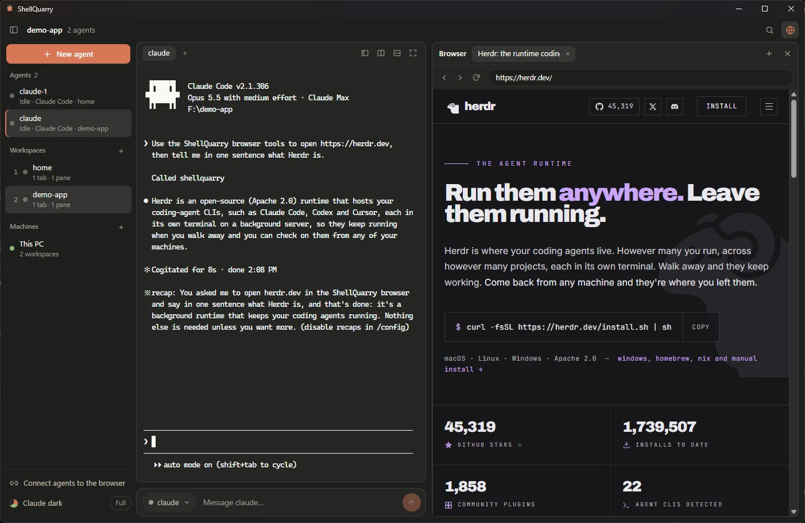

# How ShellQuarry works

ShellQuarry is a Windows app around [Herdr](https://herdr.dev), the terminal workspace manager for coding agents.
Herdr runs unchanged in the middle of the window; ShellQuarry adds a Claude Code-style interface around it and a
browser that agents can drive. This page explains how the pieces fit, why each was chosen, and how it was built.



## The pieces

| Piece | Project | What it does here |
|---|---|---|
| App window | [Tauri 2](https://github.com/tauri-apps/tauri) (Rust) | One native window holding several web views; uses Windows' built-in WebView2, so the installer is under 2 MB |
| Terminal screen | [xterm.js](https://github.com/xtermjs/xterm.js) | Draws the terminal Herdr runs in, with full colour, mouse and Unicode |
| Terminal process | [portable-pty](https://github.com/wezterm/wezterm/tree/main/pty) (from WezTerm) | Starts `herdr.exe` behind a Windows pseudoterminal (ConPTY) and streams it to xterm.js |
| Agent manager | [Herdr](https://github.com/herdrdev/herdr) | Workspaces, tabs, panes, agent status, other machines; driven through its CLI |
| Browser control | [Playwright](https://playwright.dev) (`playwright-core`) | The MCP server uses it to drive the browser tabs over WebView2's DevTools protocol |
| Agent connection | [MCP TypeScript SDK](https://github.com/modelcontextprotocol/typescript-sdk) | Exposes 14 browser tools to Claude Code, Codex and other MCP clients |

The building blocks were picked from [RepoQuarry](https://repoquarry.dev/tags/building-blocks), where each one's
licence, platforms and setup are recorded with sources.

```
ShellQuarry window (Tauri)
├── "ui" webview: sidebar, toolbar, message box, terminal (xterm.js ⇄ portable-pty ⇄ herdr.exe)
└── "tab-N" webviews: one per browser tab, placed over the browser panel
        ▲ DevTools port (random, 127.0.0.1)          ▲ control API (random port + token, 127.0.0.1)
        │                                            │
   plugin/mcp/server.mjs (Playwright) ───────────────┤
        ▲ stdio                                      │
   your agent (Claude Code, Codex...)        Herdr plugin actions (plugin/bin)
```

## The window

`src-tauri/src/lib.rs` creates one window and adds a webview for the interface (`ui/`). Browser tabs are separate
webviews (`browser.rs`) that Rust places exactly over an empty slot in the interface: the page measures the slot and
calls `browser_layout`; Rust moves the active tab there and hides the rest. Because a native webview always draws on
top of the page, the interface asks Rust to tuck the browser away while a menu, dialog or the command palette is open.

Tauri's multi-webview API is still marked unstable, so it's enabled with the `unstable` feature. All webviews share one
WebView2 environment and must be created with identical browser arguments.

## The terminal

`pty.rs` starts the first of: `SHELLQUARRY_SHELL` if set, Herdr if installed (on `PATH` or in
`%LOCALAPPDATA%\Programs\Herdr\bin`), or PowerShell. Output is read on a thread, split carefully so a multi-byte
character is never cut in half, and sent to xterm.js as events; keystrokes come back through `pty_write`. Herdr's
own `HERDR_*` variables are removed from the child's environment so a ShellQuarry launched by the Herdr plugin can
still start its own Herdr client.

Herdr gets a copy of the user's config (`herdr-config.toml` in the app's data folder, passed as
`HERDR_CONFIG_PATH`) with `sidebar_start_collapsed`, `sidebar_collapsed_mode = "hidden"`,
`pane_outer_borders = false`, the tab row always on top and no narrow layout, so it doesn't repeat what the
sidebar and toolbar show. Herdr has no setting to hide its tab row once there are two tabs, so the terminal gets one
extra row and that top line is clipped out of view. The user's own file is never written. A separate thread waits on the shell process itself, because ConPTY keeps
the output pipe open after the child exits; that is what shows "press Enter to start it again". Input is forwarded
while the shell is still starting, since Herdr asks the terminal questions at startup and waits for the answers.
xterm.js draws with its WebGL renderer, falling back to the DOM renderer when WebGL isn't available.

## Herdr's features as buttons

`herdr.rs` runs the Herdr CLI (`herdr [--machine M] <noun> <verb> …`) with a timeout and returns its JSON. Only an
allowlist of commands can be run from the interface: workspace, tab, pane, agent, worktree and machine commands.

- **Sidebar.** Every 2.5 seconds the interface asks for `workspace list`, `agent list` and the focused workspace's
  `tab list`. Saved machines are polled every 20 seconds with `machine list --json` and `--machine <id>`.
- **New agent.** `workspace create --cwd … --focus` (or `worktree create` for a new git branch), then
  `agent start <name> --kind <kind> --pane <pane>`. Agents that stop at a first-run question (Claude Code's "trust
  this folder?") come back as `agent_not_ready`; that is treated as "started, waiting for you" rather than a failure.
  Agents not installed on this PC are refused up front instead of waiting for Herdr's timeout.
- **Message box.** `agent prompt <name or pane> <text>`. Herdr refuses to type into an agent that is waiting on a
  question, which protects you from answering it by accident. The Stop button sends `agent send-keys … esc`.
- **Agent targets** are always the agent's name or its pane id; Herdr does not accept terminal ids.
- **Hiding Herdr's sidebar** sends your configured `toggle_sidebar` keys (default `prefix+b`, prefix `ctrl+b`),
  read from `%APPDATA%\herdr\config.toml`.
- **Adding a machine** opens a PowerShell window running `herdr machine add <host>`, because it may ask to approve a
  host key or install Herdr remotely.

## The browser and the agent bridge

- **Tabs.** Each tab is a webview labelled `tab-N` with an initialisation script that sets `window.__shellquarryTab`,
  so the MCP server can tell which DevTools target belongs to which tab. Links that open a new window become a new tab.
- **Full and lite mode.** Full keeps every tab loaded (up to 8). Lite keeps only the active tab alive and unloads
  everything when the panel closes (up to 4 tabs). Machines under 12 GB start in lite mode. WebView2 shares page
  processes between tabs, so in testing lite mode freed less memory than hoped; the tab cap is what limits growth.
- **The MCP server** (`plugin/mcp/server.mjs`) is started by the agent over stdio. It reads
  `%LOCALAPPDATA%\dev.repoquarry.shellquarry\session.json`, connects to the tabs with Playwright's `connectOverCDP`,
  and never touches the app's own interface. Pages are described as a list of clickable elements with refs
  (`[e12] button "Sign in"`) plus the visible text, so agents don't need a vision model. Before each click a cursor
  is drawn in the page and glides to the target, so you can follow along.

## Security

- On start the app picks a random loopback port for WebView2's DevTools and another for its control API, and a
  random 256-bit token. They are written to `session.json` in the user's local app data and removed on exit (only by
  the process that wrote it).
- The control API refuses requests without the token, requests from web pages (any `Origin` header) and requests
  with a foreign `Host` header (DNS rebinding).
- Browser tabs load remote pages without any access to Tauri's IPC; only the interface webview has it.
- The DevTools port has no token of its own; any program running as you can reach it while the app is open. That
  matches the usual desktop trust model (such a program can already read your files), and is documented in the README.
- Release builds strip local folder paths from the binary (`scripts/build.mjs` remaps them).

## The Herdr plugin

`plugin/herdr-plugin.toml` declares three actions (open, close, open link), a link handler that sends Ctrl+clicked
web links to the agent browser, and a popup pane that connects Claude Code and Codex (`bin/setup.mjs`; it asks before
changing anything). Actions talk to the running app through the control API, or start it as a browser-only window.
A second launch of the app hands its request to the running copy (Tauri's single-instance plugin) instead of
fighting over the WebView2 profile.

## Colours

`ui/themes.js` holds Herdr's 18 theme palettes, ported from Herdr's source (Apache-2.0) by
`scripts/port-herdr-themes.mjs`. The default follows the theme in Herdr's `config.toml`, including custom colours and
light/dark switching; the picker also offers Claude dark and light. Herdr draws its own screens; setting Herdr's
theme to `terminal` makes it use ShellQuarry's terminal colours.

## How it was built

ShellQuarry was built in one day (22 October 2026) with Claude Code, in steps that each ended in a working app:

1. **Prototype.** One Tauri window with a terminal and a second webview as a browser panel, driven by an MCP
   server over a fixed DevTools port. It proved the idea: an agent could open pages, click and type while you watch.
2. **Herdr plugin and security.** Herdr turned out to run natively on Windows (no WSL needed), and has a real plugin
   system. The browser became a plugin with a link handler and a setup popup; ports became random with a token.
   Testing found that a second copy of the app deleted the first copy's session file, which led to single-instance
   handling and ownership checks.
3. **Claude Code layout and colours.** Sidebar, side panel and a colour picker covering Herdr's themes and Claude's.
4. **Herdr's features as buttons.** New agent, message box, right-click menus, tabs and splits, machines, alerts,
   command palette and tour, all through Herdr's CLI.
5. **Release.** Personal details were scrubbed from the history and the binaries before the repository went public.

## Tests

With the app open, from `plugin/`:

- `node test/try-agent.mjs` runs a full agent session over MCP: tabs, search, scrolling and screenshots.
- `node test/smoke-ui.mjs` checks the globe toggle and full/lite mode.
- `node test/herdr-ui.mjs <scratch-folder>` starts Claude Code through the New agent dialog, checks the sidebar and
  message box, checks that a waiting agent can't be typed into, tries the command palette, then cleans up. It sends
  the agent nothing.

Other machines are built on Herdr's documented `machine` and `--machine` commands but haven't been tested against a
real remote machine yet.
